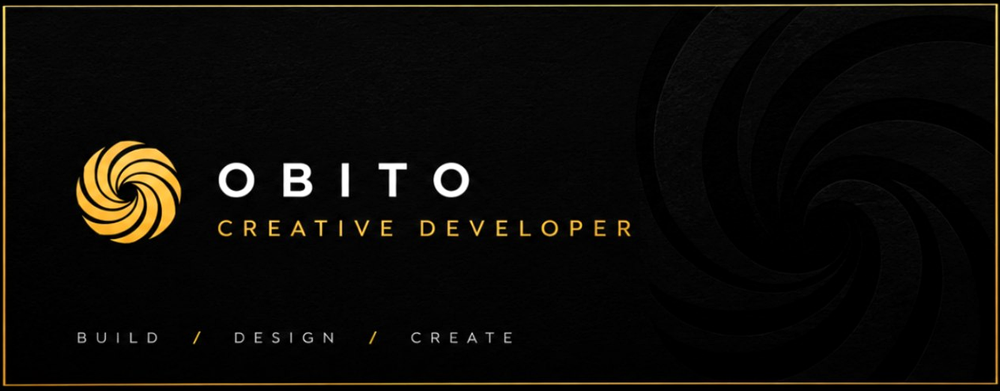

 

 

<h2>OBITO</h2>

<strong>CREATIVE DEVELOPER</strong>

BUILDING DIGITAL EXPERIENCES · ETHIOPIA

 

---

## 👋 About Me

I'm a Computer Science student at **Harambee University** in Ethiopia, interested in building useful, modern web applications.

- 💻 Focused on full-stack web development.
- 🎨 Interested in clean UI/UX and thoughtful user experiences.
- 🐍 Working with Python and Flask for backend development.
- 🌱 Improving my JavaScript, database, and software engineering skills.
- 🚀 I enjoy turning practical ideas into working projects.

---

## 🛠️ Tech Stack

### Frontend

  
  
  

### Backend & Database

  
  
  

### Tools

  
  
  
  
  

---

## 🚀 Featured Projects

| Project | Description |
|---|---|
| 🛍️ **TIME BRAND** | An Ethiopian e-commerce project for shoes and fashion products. |
| 📚 **Ethio Book Store** | An online bookstore project focused on digital books and local readers. |
| 🎓 **Ethio Exit Prep** | A web-based exam preparation platform for students. |
| 🎵 **OBITO MUSIC STUDIO** | A music discovery platform focused on Ethiopian music and artists. |
| 🩸 **BloodLink** | A web-based blood donation management system concept. |

**Explore my repositories:** [github.com/biruk926](https://github.com/biruk926?tab=repositories)

> Project descriptions and technologies should be updated as each repository reaches a working release.

---

## 📊 GitHub Analytics

---

## 🌱 Currently Learning

- Advanced JavaScript
- Full-stack application development
- Database design and management
- API development and integration
- cybersecurity

---

## 🤝 Connect With Me

  

**BUILD / DESIGN / CREATE**

**Developed by Obito** 🖤💛

